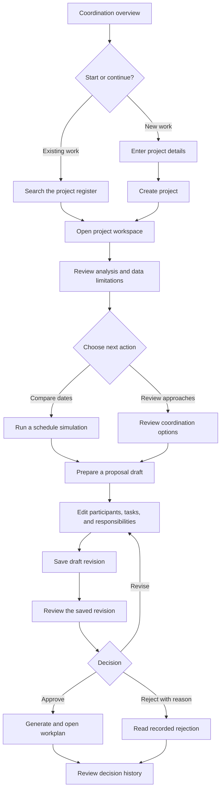

# DigInSync user flow overview

DigInSync helps Bengaluru infrastructure coordinators record proposed work,
review available evidence, compare schedules, and prepare a shared coordination
workplan. This overview describes the implemented frontend flow.

## Main journey

Users can return to saved work through Overview, Projects, or Proposals. Schedule
simulation is optional; it is not required before preparing a proposal.

## Screens and navigation

| Screen | Address | User goal |
| --- | --- | --- |
| Overview | `/` | Start a project or return to recently saved work; inspect recorded totals. |
| Projects | `/projects` | Search by road name, browse results, and open a project. |
| New project | `/projects/new` | Enter and confirm the proposed work before creating a record. |
| Project workspace | `/projects/[id]` | Review analysis, compare schedules, review coordination options, and find related proposals. |
| Proposals | `/proposals` | Find recent drafts and recorded decisions; filter returned records by status. |
| Proposal workspace | `/proposals/[id]` | Edit a draft, review its saved revision, record a decision, and inspect history. |
| Workplan | `/workplans/[id]` | Read the approved tasks, organizations, dates, and dependencies. |
| Data context | `/data-context` | Understand coverage and look up records using a source-specific ward identifier. |

Desktop navigation uses a sidebar. On smaller screens, **Open navigation** opens
the navigation drawer. **New project** and **Activity** remain in the header.
Old dashboard and proposal/workplan query links continue to resolve to the
corresponding screens.

## 1. Create a project

1. Choose **New project** or **Create a project**.
2. Complete the structured form: organization, project type, description, road
   name, start and end dates, optional length, and lane closure.
3. Optionally choose **Fill from a description**. Submit the written brief,
   review the suggested values, select the changes to accept, then choose
   **Apply selected suggestions**. Existing values are unchecked by default;
   null suggestions do not overwrite entered details.
4. Optionally search imported roads. **Preview** expands a map directly beneath
   that result; **Select segment** chooses the road reference. Previewing alone
   does not select a segment. Changing the road name clears its prior selection.
5. Choose **Create project and review analysis** to save the project and open
   its workspace.

Required fields show `*`. Missing or invalid values turn red after leaving the
field or submitting, with a linked error message. Submission focuses the first
invalid field. Length and road-segment selection are optional; **No** is a valid
lane-closure answer.

**Outcome:** a saved project containing the confirmed original schedule.

## 2. Review project evidence and explore alternatives

The project header keeps its identity, original schedule, and location-reference
status visible. Section navigation separates four tasks:

| Section | What the user does | What is saved |
| --- | --- | --- |
| Analysis | Inspect candidate counts, overlapping schedules, map/list, timeline, experimental indicator, returned inputs, and limitations. | Existing analysis operations may update stored analyses; original project dates remain unchanged. |
| Schedule comparison | Enter proposed dates, choose **Run simulation**, compare before/after results, and optionally prepare a proposal with those dates. | The simulation does not save proposed schedules or approve work. Preparing a proposal saves a draft. |
| Coordination | Choose **Review coordination options**, compare templates and tradeoffs, optionally request an AI explanation, then choose **Prepare proposal**. | Reviewing options does not approve a plan. Preparing a proposal saves a draft. |
| Proposals | Find and open saved proposals belonging to this project. | Opening a proposal does not change it. |

Moving between sections retains inputs and results without automatically
rerunning analysis. **Refresh analysis** explicitly requests fresh results.

**Outcome:** evidence for review and, when requested, a saved coordination draft.

## 3. Edit and review a proposal

1. Open a proposal from its project, Overview, or the proposal register.
2. In **Draft**, edit coordination notes, explicitly select participating
   candidates, and add or edit tasks.
3. Confirm each task's name, responsible organization, proposed dates,
   dependency, and optional notes. Dependencies must finish before dependent
   tasks start and cannot form a cycle.
4. Choose **Save draft revision**. Resolve highlighted validation errors before
   retrying a save.
5. Choose **Review saved revision** to inspect the saved participants, tasks,
   original project schedule, analysis, and warnings.
6. Return to **Draft** if changes are needed, then save and review again.

Review displays the saved revision. Unsaved edits are retained separately and
cannot be approved or rejected. The proposal register shows up to 100 recent
records; its status filters apply to those returned records.

**Outcome:** a saved revision ready for an explicit local review decision.

## 4. Record a decision and read the workplan

**Approve:** review the saved content and warnings, acknowledge the review, then
choose **Approve and generate workplan**. At least one valid saved task is
required. Approval checks the revision and freshness of the reviewed data.
Choose **Open approved workplan** to read the resulting document.

**Reject:** choose **Reject proposal**, enter the required reason in the dialog,
then choose **Record rejection**. The reason remains with the saved decision.

**After a decision:** read the outcome and reviewer details, inspect **Decision
history**, or prepare a new draft when that action is available. Completed
records display as readable documents. Workplans link back to their source
proposal and project analysis.

Editing and decisions depend on the server's local-demo configuration. If they
are unavailable, saved records remain readable. Local approval does not
authorize construction and does not change original project dates.

## Process visibility, drafts, and recovery

| Situation | What the user sees or does |
| --- | --- |
| Work is running | The compact **Workflow progress** strip shows status. Expand **View process details** for observed phases, elapsed times, request results, and explanations. |
| More process context is needed | Open **Activity** for the browser visit's request history. Persistent saved decisions are in **Decision history** instead. |
| Unsaved work exists | Project fields and proposal edits remain in memory across internal navigation. They are not autosaved and do not survive a page reload. Explicit discard asks for confirmation; leaving a dirty editor through reload or close warns the user. |
| AI is unavailable | Continue with manual project entry or deterministic coordination options. Existing entered values remain available. |
| One resource fails | Use its retry action. Other available results remain usable; retained results may be marked out of date. |
| A revision or reviewed analysis changed | Keep the local edits, reload the saved record when ready, then save and review a fresh revision before deciding. |
| A save or decision response is lost | Check saved records before submitting again. The frontend does not automatically retry mutations. |
| A decision succeeds but a later read fails | The confirmed decision remains visible. Retry loading the missing workplan or history. |

## Interpretation reminders

- End dates are exclusive throughout the flow.
- Candidate projects and projects with overlapping dates are different counts.
- A selected road segment is a location reference, not a verified excavation extent.
- Experimental indicators and fallback scores are not disruption probabilities.
- Missing or zero historical inputs do not prove an absence of incidents.
- Ward lookups describe one source dataset; they do not establish nearby
  incidents, reconciled ward boundaries, or project-level coverage.
- Process visibility reports observed requests; the backend does not stream
  individual internal checks or estimated completion percentages.

For development setup and verification, see [README.md](./README.md). For shared
visual and interaction conventions, see [UI_GUIDE.md](./UI_GUIDE.md).
